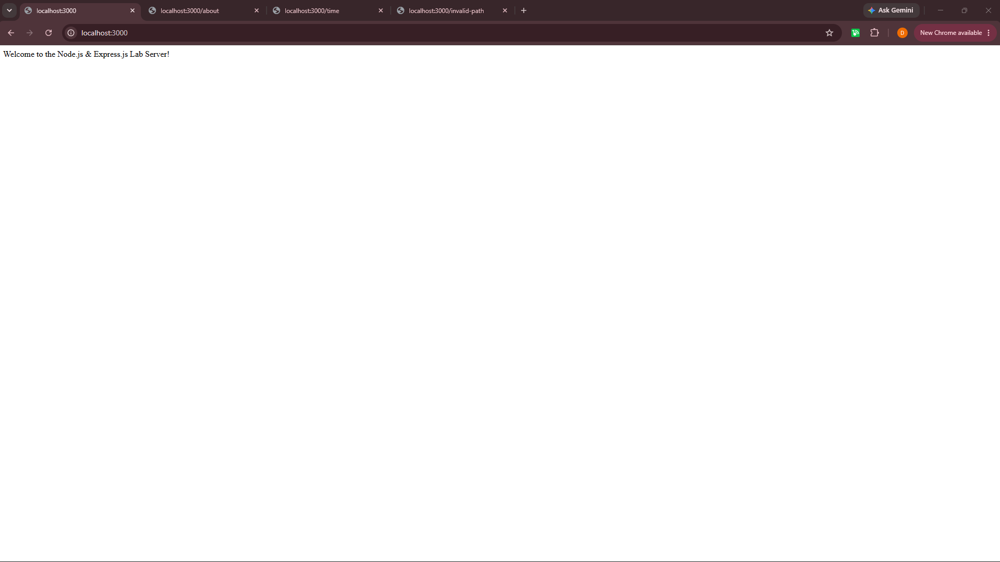
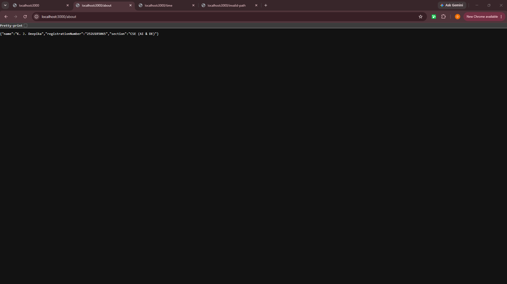
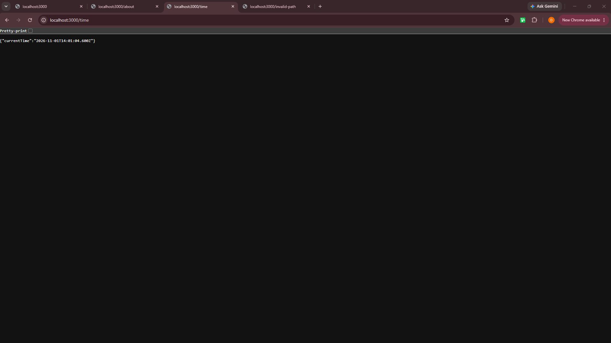
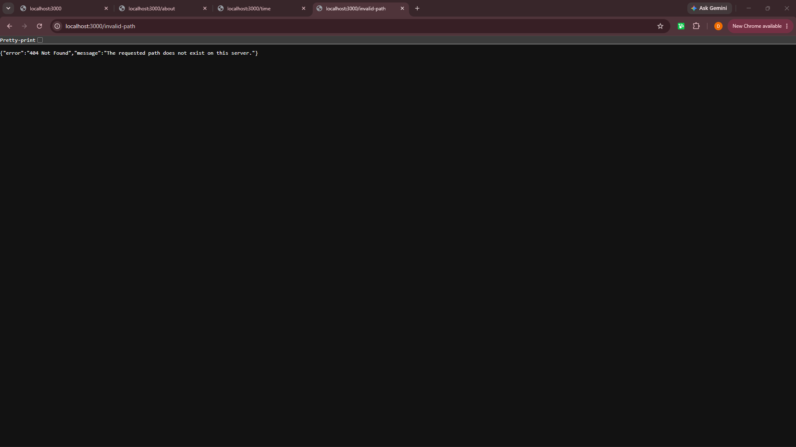

# Lab 01: Introduction to Express.js & Route Creation

## Student Identity
- **Student Name:** K. J. Deepika
- **Registration Number:** 252U1R5065
- **Section:** CSE (AI & DE)
- **Course:** Backend Development Frameworks

---

## 1. Description
This repository contains the setup and implementation of **Lab 01** for the Backend Development Frameworks course. It demonstrates setting up a Node.js runtime environment, configuring Express.js web framework routing, handling GET HTTP requests, and returning custom JSON 404 responses.

---

## 2. API Endpoints

Local Base URL: `http://localhost:3000`

| HTTP Method | Endpoint | Description |
| :--- | :--- | :--- |
| **GET** | `/` | Returns welcome message |
| **GET** | `/about` | Returns student identity in JSON format |
| **GET** | `/time` | Returns current server timestamp in JSON format |
| **GET** | `/*` (Invalid Path) | Returns 404 Error message in JSON format |

---

## 3. Technologies Used
- **Runtime Environment:** Node.js
- **Web Framework:** Express.js
- **Development Utility:** Nodemon
- **Version Control:** Git & GitHub

---

## 4. Screenshots

### GET / - Home Route

### GET /about - About Route

### GET /time - Time Route

### GET /invalid-path - 404 Error Route
