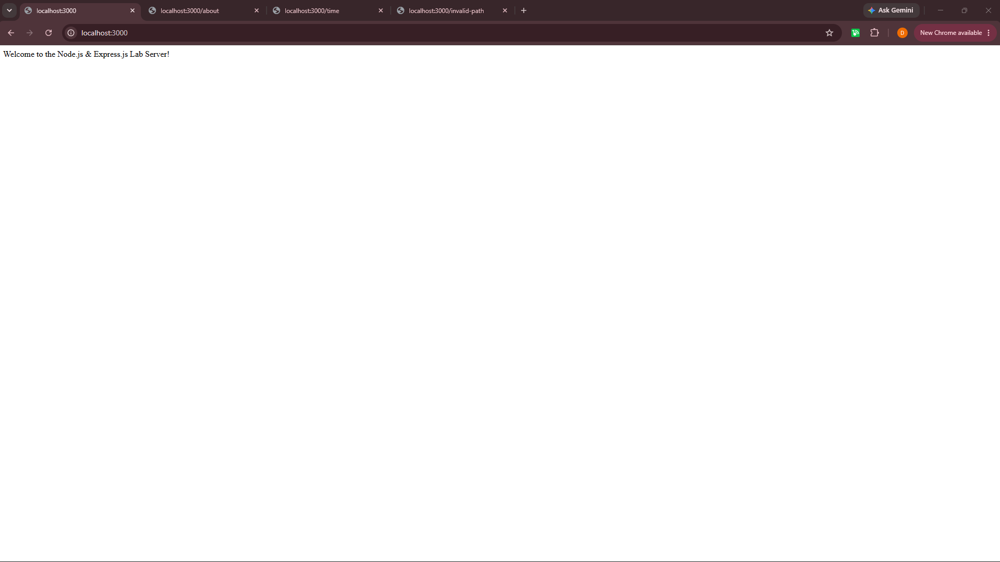
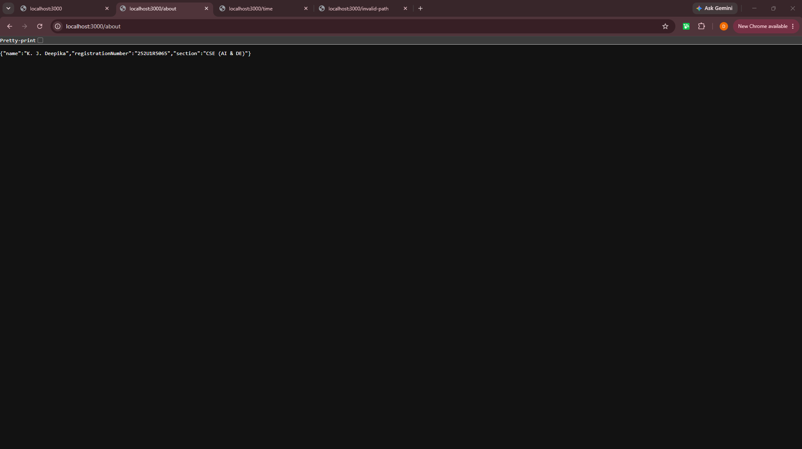
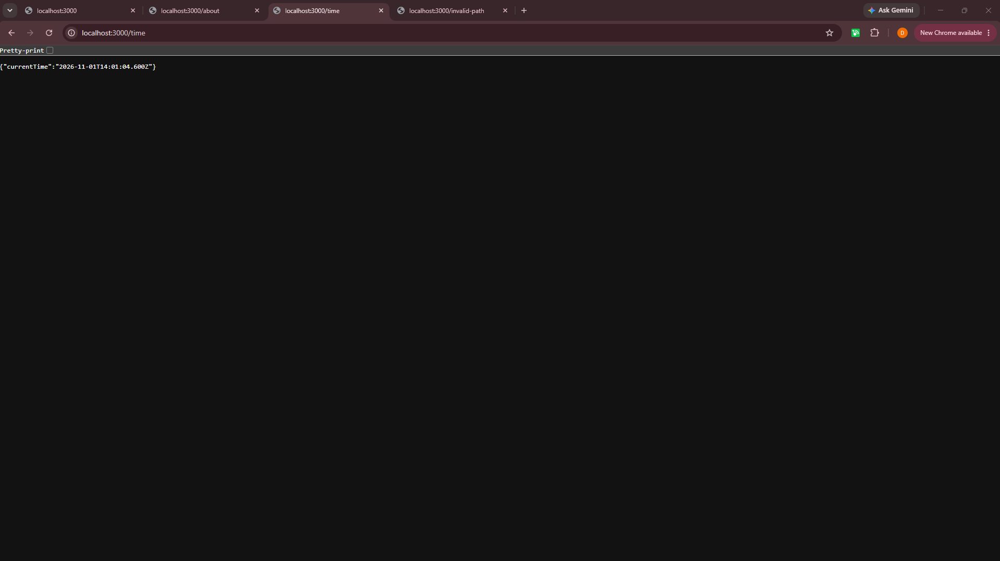
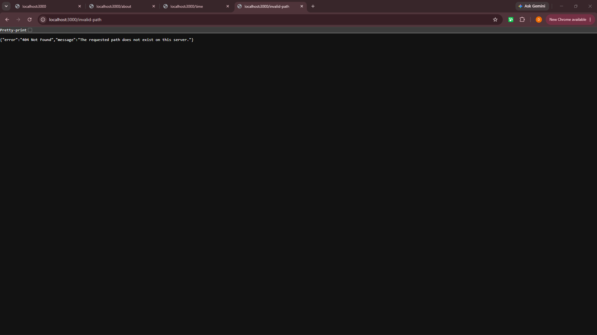

# Lab 01: Introduction to Express.js & Route Creation

## Student Identity
- **Student Name:** K. J. Deepika
- **Registration Number:** 252U1R5065
- **Section:** CSE (AI & DE)
- **Course:** Backend Development Frameworks

---

## 1. Objective
To build, configure, and deploy a basic Node.js and Express.js web server handling custom HTTP GET routes, managing academic identity endpoints, returning structured JSON responses for valid and invalid paths, and publishing the live web application on Render.

---

## 2. Project Description
This project demonstrates the creation of a foundational web server using Node.js and Express.js for Lab 01 of the Backend Development Frameworks course. It features four distinct API endpoints that respond with text and JSON structures, custom 404 error handling for undefined routes, complete local screenshot documentation, and live deployment on Render.

---

## 3. Technologies Used
- **Runtime Environment:** Node.js
- **Web Framework:** Express.js
- **Development Tools:** Nodemon
- **Deployment Platform:** Render
- **Version Control:** Git & GitHub

---

## 4. Project Structure

```text
Deepika-BDF/
└── lab-01/
    ├── node_modules/
    ├── screenshots/
    │   ├── home.png
    │   ├── about.png
    │   ├── time.png
    │   └── unknown.png
    ├── .gitignore
    ├── package.json
    ├── package-lock.json
    ├── README.md
    └── server.js

##  5.API Endpoints
Local Base URL: http://localhost:3000

Live Base URL: https://deepika-lab-1.onrender.com

HTTP Method	Endpoint	Description
GET	/	Returns welcome message
GET	/about	Returns student identity details in JSON format
GET	/time	Returns current server timestamp in JSON format
GET	/* (Invalid Path)	Returns custom 404 Error message in JSON format

## 6. Screenshots
GET / - Home Route
GET /about - About Route
GET /time - Time Route
GET /invalid-path - 404 Error Route
## 7. Execution & Running Locally
Clone the repository:

Bash


git clone [https://github.com/deepikakaradi/Deepika-BDF.git](https://github.com/deepikakaradi/Deepika-BDF.git)
cd Deepika-BDF/lab-01
Install dependencies:

Bash


npm install
Start the development server with Nodemon:

Bash


npm run dev
Access endpoints in your browser:
Navigate to http://localhost:3000/.

## 8. Deployment
The application is deployed live on Render:

Deployment Platform: Render

Live Base URL: https://deepika-lab-1.onrender.com
## Screenshots

### GET / - Home Route


### GET /about - About Route


### GET /time - Time Route


### GET /invalid-path - 404 Error Route

## Testing
The endpoints should be tested by opening their URLs in a web browser.

The following checks should be performed:

Open / and check that the welcome message is displayed with status code 200.

Open /about and check that the student's name, registration number, and section are returned as JSON with status code 200.

Open /time and check that the current date and time are displayed with status code 200.

Open an unknown route, such as /unknown, and check that the server returns status code 404.

The screenshots in the screenshots/ folder provide evidence of the endpoint responses.

## Notes: Problems Faced and Solutions
GitHub upload: I learned how to stage, commit, and push the project files to GitHub using Git commands.

Node modules: I added node_modules/ to .gitignore to prevent uploading installed dependencies to GitHub. Dependencies can be installed again using npm install.

Deployment: I configured the Node.js project for deployment on Render and obtained a public deployment URL.

Testing: I used a web browser to check the server responses and verify the expected endpoints.

## Important Notes
Install dependencies using npm install.

Do not upload the node_modules/ folder to GitHub.

Do not commit or share any .env file containing secrets.

The basic HTTP server and Express server both use port 3000, so run them one at a time.

Ensure all screenshot files exist in the screenshots/ folder.

Verify the endpoint responses and status codes before submission.